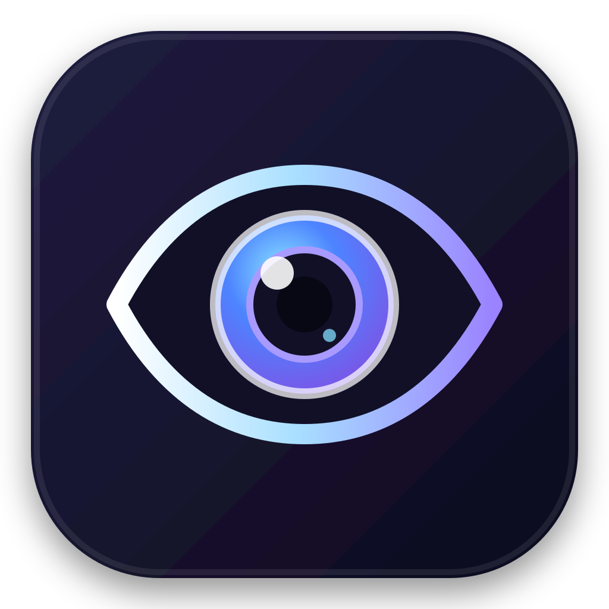
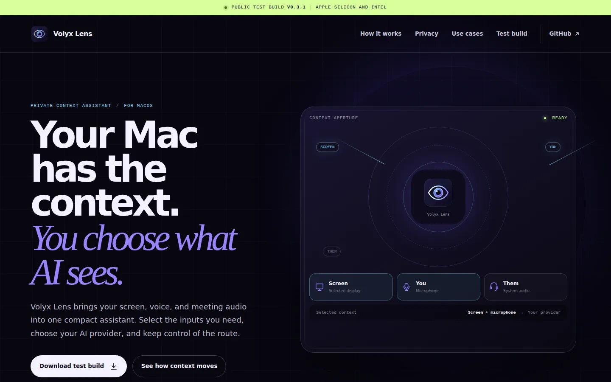
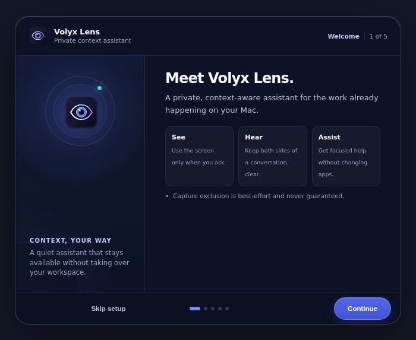
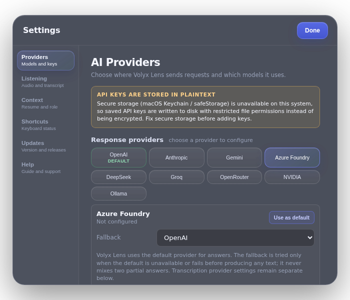
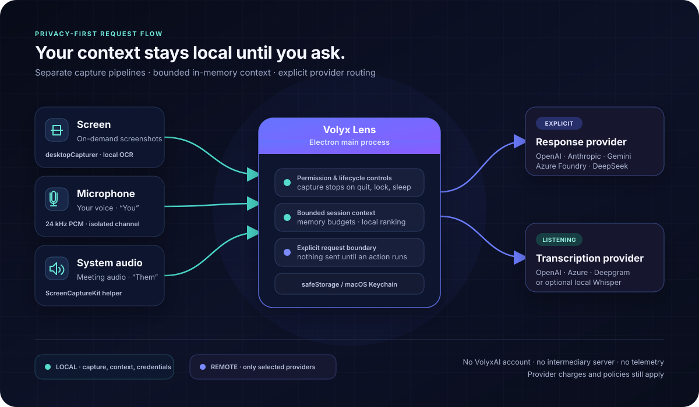

<div align="center">



# Volyx Lens

**A user-controlled, context-aware AI assistant for macOS, Windows, and Linux.**

Use your screen, voice, meeting audio, and saved Task Context with the AI provider you choose. Requests go directly from the app to that provider rather than through a Volyx Lens-operated server. You choose when to capture and what context to send. On macOS, the overlay uses the operating system's protected-window mechanism to reduce accidental exposure of its contents in supported capture tools; this is a privacy safeguard, not a way to conceal use. Support varies by platform and capture tool, and exclusion is never guaranteed.

[**Explore the live site**](https://volyxlens.pages.dev/) · [Download](#download) · [Product tour](#product-tour) · [Architecture](docs/architecture.md) · [Privacy](#privacy-and-security)

<br />

<a href="https://volyxlens.pages.dev/">
  
</a>

<sub>Live product site: <a href="https://volyxlens.pages.dev/">volyxlens.pages.dev</a></sub>

</div>

---

> [!IMPORTANT]
> **Use Volyx Lens transparently and with consent.** Tell people when you are capturing or transcribing conversations, and get any consent required by law, policy, or the people involved. Disclose AI assistance when an exam, interview, workplace, platform, or other setting requires it. Do not use capture protection to hide recording or assistance, or to bypass those rules. Capture exclusion is best-effort, never guaranteed; modern capture tools or a physical camera may still show the app.

## Why Volyx Lens

Volyx Lens is a compact glass overlay, a private AI assistant for macOS, Windows, and Linux (Linux support is experimental), that can use three intentionally separate inputs:

- **Screen:** screenshots are captured only for an explicit screen-based action.
- **Microphone / “You”:** your voice is transcribed on its own channel.
- **System audio / “Them”:** meeting audio is captured per platform — ScreenCaptureKit helper on macOS, system-audio loopback on Windows, and a PulseAudio/PipeWire monitor on Linux (best-effort).

Nothing is routed through a Volyx Lens-operated server. Provider requests go directly from the app to the AI or transcription provider you configure.

### Highlights

- **Screen-aware assistance:** ask about the visible screen, a conversation, or both.
- **Separated meeting transcript:** stable timestamped **You** and **Them** turns.
- **Task Context:** save multiple screens locally, pin important captures, deduplicate near-identical views, and attach a bounded relevant set only when you explicitly ask.
- **Meeting detection:** opt-in detection flags a sustained two-sided conversation while listening, tags the session, and shows a "Meeting in progress" indicator. Local and in-session only: no audio watcher, no disk writes, no model calls.
- **Meeting history and recovery:** when enabled, finalized meetings and an in-progress transcript checkpoint are saved on device. After an unexpected exit, choose whether to restore or discard the draft.
- **Meeting notes:** generate structured notes (Summary, Key Points, Decisions, Action Items, Follow-Up) for saved records using your configured provider, with long-meeting confirmation before paid requests. Notes persist in meeting history.
- **Slide tracking:** optional local slide-change detection while listening, with bounded in-memory previews and nearby transcript context; no automatic provider requests.
- **Provider choice:** 9 response providers (OpenAI, Anthropic, Gemini, Azure Foundry, DeepSeek, Groq, OpenRouter, NVIDIA, or a local Ollama server). Realtime transcription runs on OpenAI, Azure Foundry, Deepgram, or Azure AI Speech; batch transcription falls back to OpenAI, Gemini, or Groq Whisper, with optional local Whisper. OpenAI and Azure support both roles.
- **Transcription language:** pick a language or let providers auto-detect; the selection is honored per job and normalized for cloud and local Whisper routes.
- **Personal context:** import a resume/CV and job description with bounded extraction and relevance selection.
- **Local controls:** clear sessions, export transcripts, inspect sanitized diagnostics, and stop capture immediately.
- **Native macOS and Windows behavior:** compact draggable overlay, edge-aware expanded docking, Keychain-backed credential storage, and best-effort capture exclusion.
- **Overlay privacy:** the overlay asks the operating system to keep itself out of supported capture tools: `NSWindowSharingNone` on macOS and `WDA_EXCLUDEFROMCAPTURE` on Windows 10 2004 and later. Support varies by tool, older Windows versions capture a black window, and Linux has no equivalent API. This is not guaranteed and is not intended to conceal use; see [Platform support](#platform-support).

## Product tour

These captures come from the current Electron UI test harness. Provider values shown in Settings are sanitized examples.

<table>
  <tr>
    <td width="50%" align="center">
      <a href="docs/onboarding-welcome-eye.png">
        
      </a>
      <br />
      <sub><strong>Guided onboarding</strong>: five focused steps for permissions, providers, sharing, and readiness.</sub>
    </td>
    <td width="50%" align="center">
      <a href="docs/settings-providers.png">
        
      </a>
      <br />
      <sub><strong>Provider control</strong>: choose the default and fallback without exposing stored secrets to the renderer.</sub>
    </td>
  </tr>
</table>

## Download

### Current release: v0.7.3

What changed in this release:

- A saved meeting can be cleaned up after the call. The transcript is repaired turn by turn for readability, the wording that was heard is kept beside it, a Changes view shows only the turns whose words moved, and cleanup can be discarded with one action.
- The other speaker can be named. The name appears in the transcript, the Markdown, TXT and JSON exports, the SRT and VTT subtitles, and the notes.
- Notes record which transcript they were generated from and prompt a regenerate when they predate a cleanup.
- History can be kept tidy: a retention window in Settings, and a Select mode for deleting several meetings behind one confirmation.
- Realtime transcription is seeded with the names and product terms in your personal context documents, which is where recognisers usually go wrong.
- The history pane works from the keyboard, and the app now runs as a single instance.

v0.7.3 publishes a Windows NSIS installer, Linux AppImages (x64 and arm64), and unsigned macOS DMGs for Apple Silicon and Intel. Signed and notarized macOS DMGs replace the unsigned ones once release signing credentials are configured. Windows, Linux, and the attached macOS DMGs are all unsigned; Windows shows a SmartScreen warning and macOS needs the right-click Open step below. Signed and notarized macOS builds launch without that step once credentials are configured. Auto-update metadata is published for Windows and Linux; the macOS updater is published together with the DMGs.

| Mac | Installer |
|---|---|
| **Apple Silicon:** M1, M2, M3, M4, or newer | [v0.7.3 unsigned DMG](https://github.com/dk3yyyy/volyx-lens/releases/download/v0.7.3/volyx-lens-0.7.3-mac-arm64-unsigned.dmg) · right-click Open |
| **Intel** | [v0.7.3 unsigned DMG](https://github.com/dk3yyyy/volyx-lens/releases/download/v0.7.3/volyx-lens-0.7.3-mac-x64-unsigned.dmg) · right-click Open |

| Windows / Linux | Installer |
|---|---|
| **Windows (x64)** | `volyx-lens-0.7.3-win-x64.exe` |
| **Linux (x64)** | `volyx-lens-0.7.3-linux-x86_64.AppImage` |
| **Linux (arm64)** | `volyx-lens-0.7.3-linux-arm64.AppImage` |

**[Open the v0.7.3 release and download the matching installer →](https://github.com/dk3yyyy/volyx-lens/releases/tag/v0.7.3)**

The Windows installer is unsigned and shows a SmartScreen "Unknown publisher" warning on first launch; the Linux AppImages are unsigned but run directly after `chmod +x`. The v0.7.2 release page was consolidated: installers, macOS DMGs and update manifests only, with every SHA-256 checksum in the release notes instead of as separate files. Later tag-triggered releases publish per-file checksum and SBOM files alongside the installers. Signed and notarized builds will replace them once release signing credentials are configured.

### Install on Windows and Linux

1. **Windows:** run `volyx-lens-0.7.3-win-x64.exe` and follow the installer. If SmartScreen warns the publisher is unknown, choose **More info → Run anyway** after verifying the published SHA-256 checksum.
2. **Linux:** make the matching AppImage executable (`chmod +x volyx-lens-0.7.3-linux-x86_64.AppImage` or `...-linux-arm64.AppImage`) and run it. The Them channel additionally needs `pactl` and `parec` (`pulseaudio-utils`, or PipeWire's PulseAudio compatibility) and an active default audio sink.

### Install the DMG

1. Download the DMG matching your Mac architecture.
2. Open it and drag **Volyx Lens** into **Applications**.
3. Clear quarantine once, then launch:

```bash
xattr -cr "/Applications/Volyx Lens.app"
open "/Applications/Volyx Lens.app"
```

The current DMGs are unsigned, so a bare double-click is refused and macOS may call the app damaged. Right-click → **Open** also works on most versions, but the `xattr` command is the reliable fix. Signed and notarized builds will skip this step once credentials are configured.
4. Grant Microphone and Screen & System Audio Recording access when prompted.

Ad-hoc verification builds are produced as workflow artifacts from the Actions tab; they are not published as releases.

## Platform support

| Capability | macOS | Windows | Linux |
|---|---|---|---|
| Release artifact | Unsigned DMG (signed and notarized once credentials are configured) | NSIS installer via release CI | AppImage (x64/arm64) via release CI |
| Microphone (You channel) | ✅ | ✅ | ✅ |
| Screen + coding help | ✅ | ✅ | ✅ |
| Meeting audio (Them channel) | ✅ ScreenCaptureKit helper | ✅ system-audio loopback | ⚠️ best-effort via PulseAudio/PipeWire monitor |
| Local OCR for Task Context ranking | ✅ Apple Vision | ❌ falls back to recency/pinned | ❌ falls back to recency/pinned |
| Capture exclusion from screen shares | ⚠️ best-effort | ⚠️ best-effort (`WDA_EXCLUDEFROMCAPTURE`, Windows 10 2004+) | ❌ no OS capture-exclusion API |

Notes:

- Meeting audio on Windows is captured through the OS system-audio loopback (no permission beyond the microphone grant). It is implemented and exercised in CI but has not yet been validated on a wide range of real Windows machines and audio setups.
- Meeting audio on Linux requires `pactl` and `parec` (provided by `pulseaudio-utils`, or PipeWire's PulseAudio compatibility) and an active default audio sink. Linux is experimental; the Them channel fails gracefully with a status message when the tools or a monitor source are unavailable.
- Capture exclusion only exists where the operating system provides it: macOS (`NSWindowSharingNone`) and Windows 10 2004 or later (`WDA_EXCLUDEFROMCAPTURE`). Older Windows builds capture the window as black rather than removing it. Linux has no capture-exclusion API, so the overlay can appear in screen shares there. ScreenCaptureKit-based recorders and a physical camera can still capture the window on any platform.

## What it can do

| Action | Trigger | Context used |
|---|---|---|
| **Assist** | `⌘` `↵` or Assist | screen, conversation, or both (you choose) |
| **Solve what’s on screen** | `⌘` `H` | current screen |
| **Add Task Context screen** | `⌘` `⇧` `C` or Add screen | local capture only; no AI request |
| **What should I say?** | action button | conversation transcript |
| **Follow-up questions** | action button | conversation transcript |
| **Draft answer** | button on a detected question | conversation transcript |
| **Auto-assist** | opt-in Setting (off by default): auto-drafts replies to confidently detected questions; cooldown and confidence are configurable | conversation transcript |
| **Recap** | action button | bounded meeting transcript |
| **Detect meetings** | opt-in Setting (off by default): tags a sustained two-sided conversation while listening, with a "Meeting in progress" indicator | finalized transcript turns only, in memory |
| **Save meeting history** | opt-in Setting (off by default): keeps the session record on device when listening stops | transcript + meeting flag |
| **Search meetings** | history browser | on-device meeting history |
| **Generate meeting notes** | button on a saved meeting | saved transcript through your provider |
| **Clean transcript** | button on a saved meeting | the whole saved transcript through your provider, in one or more requests |
| **Ask anything** | type and press `↵` | selected screen/conversation context |
| **New Session** | `/new` or New Session | clears in-memory session context |
| **Emergency quit** | `⌘` `⇧` `X` or power button | stops capture and clears session media context |

The **Smart** toggle selects the configured higher-capability model. Settings reports whether each global shortcut registered successfully and keeps equivalent visible buttons available.

On Windows, press **Ctrl** wherever **⌘** appears in this table. Volyx Lens relabels its keyboard-shortcut hints automatically on Windows.

## Setup

### 1. Grant macOS permissions

Volyx Lens requests only the permissions its capture features need; it does not request camera access.

- **Microphone:** System Settings → Privacy & Security → **Microphone**
- **Screen and meeting audio:** System Settings → Privacy & Security → **Screen & System Audio Recording**

If access was previously denied, enable Volyx Lens in System Settings, then fully quit and reopen it. macOS associates permission grants with the effective app identity, so replacing an ad-hoc build can require granting access again.

### 2. Configure providers

Open Settings with `⌘` `,` or the `…` button. Choose a response provider, enter its key and model/deployment names, then select **Use as default**. An optional fallback provider is used only when it is capable of the request and the default fails before producing answer text.

Each provider stores separate **Fast** and **Smart** model/deployment names, so the Smart toggle switches tiers without extra configuration. If your fast and smart models live on different APIs, the per-provider **Tier API keys** fields (Fast key / Smart key) let each tier use its own key, and the **Endpoint overrides** fields (Fast URL / Smart URL) route each tier to its own OpenAI-compatible base URL; leaving either blank uses the shared provider key / default endpoint. Tier keys apply to Azure, DeepSeek, Groq, NVIDIA, and OpenRouter. Azure endpoint overrides still pass through official-endpoint validation.

| Provider | Role | Configuration notes |
|---|---|---|
| **OpenAI** | responses + transcription | API key; compatible response and audio models |
| **Anthropic** | responses | API key; transcription requires another provider |
| **Google Gemini** | responses + batch transcription | Gemini API key |
| **Azure Foundry** | responses + realtime transcription | resource key, official resource endpoint, and exact deployment names |
| **DeepSeek** | text and screen | Flash reads screenshots; Smart (V4 Pro) is text-only, so turn Smart off or pick another provider for screen features |
| **Groq** | text responses | API key; fast Llama models served on Groq's LPU |
| **OpenRouter** | responses | API key; routes to many hosted models with one key |
| **NVIDIA** | responses | API key from build.nvidia.com; OpenAI-compatible Nemotron and hosted open models (`https://integrate.api.nvidia.com/v1`); vision requires a VLM model (e.g. `meta/llama-3.2-11b-vision-instruct`) |
| **Ollama** | local responses | no key; local server with the OpenAI-compatible API (`http://localhost:11434/v1`); pull a model first |
| **Deepgram** | realtime transcription | dedicated key; Nova streaming models |
| **Azure AI Speech** | realtime transcription | Speech resource key and region (bare region name, e.g. `eastus`); no model name required |
| **Local Whisper** | optional offline batch transcription | in-app whisper.cpp model download; audio transcribed in memory; disabled by default |

Choose a key that covers the features you use. A restricted OpenAI project key that only allows chat returns `403` on transcription. Anthropic has no speech-to-text, so pair it with an OpenAI, Gemini, Deepgram, Azure, or local Whisper key for listening. Gemini covers chat and transcription with one key.

Keys stay in the Electron main process and are protected with `safeStorage` / macOS Keychain where available. The renderer receives credential status, not stored secret values. Settings warns if secure storage is unavailable.

### 3. Understand screen-share behavior

Capture behavior depends on your operating system and the app being used to share or record. On macOS, some tools honor Volyx Lens's protected-window flag and ScreenCaptureKit-based tools may not. On Windows 10 2004 or later the window is removed from capture through `WDA_EXCLUDEFROMCAPTURE`; older Windows versions capture it as a black window. Linux has no OS-level capture exclusion. Assume the overlay may be visible, and do not rely on capture protection to conceal recording or AI assistance.

## Task Context

Task Context is for work revealed across multiple screens, for example a problem statement, source files, and test output.

- **Add screen** saves a compressed capture in bounded process memory without contacting a provider.
- Exact SHA-256 and a local visual fingerprint reduce duplicate captures.
- Optional Apple Vision OCR runs locally and is used for overlap detection and relevance ranking; recognized text is not sent as a separate provider payload.
- Pinning protects important screens from ordinary eviction and prioritizes them for later requests.
- Remove, Undo last, Clear, and New Session provide explicit lifecycle control.
- A screen request attaches at most **39 images in total, including the current screen**, or the selected provider's per-request image cap when that is lower (NVIDIA caps at one image). Before eight or more saved screens are uploaded, Volyx Lens shows the selected provider and image count and requires confirmation.
- Screens that are not selected remain local and are not presented as processed.

Task Context cannot read files or code that never appeared on screen. Use it only when external assistance is permitted.

## Meetings

Meeting detection is opt-in from Settings → Listening and runs locally in-session. Meeting history and crash recovery are also opt-in there and persist transcript text on device.

- **Detect meetings** looks for a sustained two-sided conversation between the Mic and System channels while listening, then shows a subtle "Meeting in progress" indicator and tags the session as a meeting. Detection runs only on finalized in-memory transcript turns: no background audio watcher, no disk writes, and no AI requests.
- **Save meeting history** keeps the session record on device when listening stops (capture stop, new session, or app quit). Saved records are searchable in the history browser and show a meeting badge when the session was detected as a meeting.
- While **Save meeting history** is enabled, the in-progress transcript is atomically checkpointed to a restricted-permission local file so it can be restored after an unexpected exit. On next launch, choose **Restore transcript** or **Discard draft**. No raw audio is saved; turning history off or clearing history removes the recovery draft.
- **Export** a saved record as Markdown, TXT, or structured JSON through a native save dialog.
- **Back up all** writes every saved meeting into a folder you choose, one file per record plus an index. **Restore** reads that folder back through the same validation a captured meeting goes through, reports how many records it can read and how many older ones the 200 meeting limit will remove, and asks before writing anything. Restoring is refused while Save meeting history is off, because restoring writes saved meetings.
- **Clean transcript** repairs speech-recognition damage in a saved session so it reads properly: misheard words that are obvious from context, punctuation, capitalisation, and accidental stutters. Every turn keeps its place and nothing is summarised. A turn the provider cannot repair cleanly keeps its original wording, the exact transcript is always kept and one click away, and multi-request cleanups ask for confirmation before any paid request is made.
- **Generate meeting notes** turns a saved transcript into structured notes using your configured provider. Notes include a Summary, Key Points, Decisions, Action Items, and Follow-Up. Notes are saved alongside the meeting and load instantly when reopened. Long meetings need multiple model requests and require explicit confirmation before paid requests are made.

History is stored on device and cleared with the Clear history action; it is never uploaded to a Volyx Lens-operated server. Up to 200 saved meetings are kept: when the limit is reached the oldest record is removed to make room, and the history panel says how many were removed. Export any record you need to keep.

Deleting one meeting or a selection is recoverable: the record moves to a delete undo folder for 30 days, the history panel offers Undo right after, and Restore deleted brings back anything still inside that window, including after a relaunch. Clear all is permanent, because it is the action someone takes when they want the transcripts gone, so it removes the saved records and the undo copies with them. The retention window and the 200 meeting limit also remove records permanently, and the panel reports each removal.

## Slide tracking

Slide tracking is off by default. When enabled in **Settings → Listening → Track presentation slides**, Volyx Lens samples the display containing its window about every three seconds while Listening is active. Frame comparison happens locally; a preview is retained only after a stable visual change, with up to four nearby finalized transcript turns when available. The in-memory history is limited to 20 previews and 8 MB total.

Tracked previews and transcript excerpts are bounded, kept in memory only, and shown in the transcript workspace while tracking is active. Use **Clear** at any time. They are cleared when Listening stops, a new session starts, or the transcript is cleared. This feature does not send screenshots or transcript excerpts to a provider automatically.

## How it works

<div align="center">
  
</div>

Volyx Lens is an Electron application with a sandboxed renderer and a privileged main process:

1. **Capture stays separated.** Screens, microphone PCM, and system-audio PCM have distinct lifecycles.
2. **Local controls run first.** Permission checks, memory budgets, deduplication, OCR ranking, cancellation, and secure credential access happen locally.
3. **The user triggers a request.** Screen and transcript context is attached only for the selected action.
4. **The main process routes directly.** Requests go to the configured response or transcription provider, never through a Volyx Lens-operated intermediary.
5. **Results stream into the overlay.** Provider failures are reduced to sanitized, actionable states rather than exposing credentials or raw SDK errors.

Realtime microphone audio is deterministically resampled to 24 kHz mono PCM. System audio stays a separate **Them** channel and comes from a bundled ScreenCaptureKit helper on macOS, Chromium system-audio loopback on Windows, or a PulseAudio/PipeWire monitor helper on Linux. Optional local Whisper uses an in-app whisper.cpp model download, is disabled by default, and does not silently fall back to cloud transcription unless cloud fallback is separately enabled.

For a deeper dive into the process split, preload bridge surface, provider routing, and capture pipelines, see [docs/architecture.md](docs/architecture.md).

## Privacy and security

- **No Volyx Lens-operated account, intermediary server, or product telemetry.** Selected third-party providers still receive the data required for explicit requests and apply their own terms and pricing.
- **Consent and disclosure matter.** Get any required consent before capturing or transcribing other people's speech, and disclose AI assistance wherever rules or expectations require it. Never use privacy controls to evade those obligations.
- **No persistent screenshots or audio.** Volyx Lens keeps active session media in memory; New Session or emergency quit clears it.
- **Bounded personal context.** Imported documents store extracted text and status, not the original file path or raw document, and send only relevant bounded excerpts for answer-oriented actions. While personal-context documents are enabled, up to 40 names and product terms from them also seed speech-recognition vocabulary, so those terms reach your transcription provider with the session (batch prompt, Deepgram keyterms, or Azure Speech phrases). Disable the documents and they stop being sent; a short fixed list of generic transcription words remains.
- **Sandboxed UI.** Chromium sandboxing, context isolation, no renderer Node integration, restrictive CSP, denied popup/navigation requests, and bounded IPC payloads are enabled.
- **Protected secrets.** Credentials are accessed in the main process and use `safeStorage` / Keychain when available.
- **Explicit expensive requests.** Large multi-image requests, multi-part long-meeting recaps, and multi-request transcript cleanups require confirmation.
- **Opt-in slide tracking.** Screen samples are compared locally while Listening is active; only stable-change previews are held in bounded memory and nothing is sent to a provider automatically.
- **Best-effort overlay privacy.** `setContentProtection(true)` / `NSWindowSharingNone` may reduce accidental capture on macOS, but is not a security guarantee or a concealment feature.

## Transcript workspace

While listening, confirmed provider chunks are grouped into timestamped **You** and **Them** turns. Partial text remains visually distinct and is replaced by confirmed text. The workspace can:

- copy one turn or the complete confirmed transcript;
- export TXT, Markdown, or structured JSON through a native save dialog;
- clear the session with confirmation;
- show sanitized diagnostics without keys, endpoints, raw audio, images, personal-context text, or transcript content.

Long answer requests use bounded recent context. Longer recaps use bounded part summaries and require confirmation before multiple paid provider requests are made.

## Troubleshooting

<details>
<summary><strong>macOS says the app is damaged or cannot be opened</strong></summary>

Delete the copy and download the matching DMG from this repository’s release page again. Verify its SHA-256 checksum. For the current ad-hoc test build, use Finder’s Control-click/right-click → **Open** flow. Never disable Gatekeeper globally.
</details>

<details>
<summary><strong>Permission is enabled but capture still fails</strong></summary>

You may have granted permission to an older ad-hoc build. Toggle Volyx Lens off and on in the relevant Privacy & Security pane, then fully quit and reopen the current app. Rebuilt ad-hoc apps can receive a different effective identity.
</details>

<details>
<summary><strong>Listening connects but no transcript appears</strong></summary>

Verify the selected realtime provider and exact deployment/model configuration. For Azure, use the official resource endpoint, resource key, and exact realtime transcription deployment name. Stop listening before changing settings, then use **Test Live Mic** to send a bounded five-second sample and require a real transcript. Provider billing may apply.
</details>

<details>
<summary><strong>Volyx Lens appears in a Zoom share</strong></summary>

Select **Advanced capture with window filtering** in Zoom as shown above. Capture exclusion remains best-effort, especially on newer macOS capture paths.
</details>

<details>
<summary><strong>Windows: the installer shows an “Unknown publisher” (SmartScreen) warning</strong></summary>

Windows may warn that a build is unsigned. Choose **More info → Run anyway** and verify the SHA-256 checksum published with the release before installing.
</details>

<details>
<summary><strong>Windows: listening connects but your mic stays silent</strong></summary>

Turn on **Settings → Privacy & security → Microphone → Let desktop apps access your microphone**. The top-level Microphone toggle alone is not enough for desktop apps. Screenshots and meeting audio need no extra permission on Windows.
</details>

<details>
<summary><strong>Volyx Lens fails to start with “Cannot read properties of undefined (reading 'getPath')”</strong></summary>

Something in your environment set `ELECTRON_RUN_AS_NODE=1`, which makes Electron boot as plain Node. Some editors and terminals set it, notably VS Code's integrated terminal. Clear it and relaunch: `unset ELECTRON_RUN_AS_NODE` (PowerShell: `Remove-Item Env:\ELECTRON_RUN_AS_NODE`).
</details>

<details>
<summary><strong>An answer or transcription returns “403” / “no access to model”</strong></summary>

Your API key is restricted. An OpenAI project key that only allows chat returns `403` on transcription (Whisper). Use an unrestricted key, enable audio on the key, or add a separate transcription key as described under Configure providers.
</details>

<details>
<summary><strong>Local Whisper is slow or runs out of memory</strong></summary>

Prefer `base.en` or an int8-quantized model in Settings → Listening. The model label (e.g. 139M params) is a parameter count, not a runtime memory requirement; larger models need substantially more memory and CPU/GPU time.
</details>

## Build from source

Requirements:

- macOS 13+, Windows 10/11, or a recent Linux distribution
- [Node.js](https://nodejs.org) 20+ installed
- npm (bundled with Node.js)
- macOS only: Xcode Command Line Tools (`xcode-select --install`) for native OCR and system-audio helpers
- Linux only (for the Them channel at runtime): `pactl` and `parec` from `pulseaudio-utils` (or PipeWire's PulseAudio compatibility) and an active default audio sink

```bash
git clone https://github.com/dk3yyyy/volyx-lens.git
cd volyx-lens
npm ci
npm start
```

Run the verification suite:

```bash
npm test
npm run check:syntax
npm run security:secrets
npm audit --audit-level=low
npm run release:check
```

`npm run coverage` and the c8 threshold check measure `src/`. `main.js`, `preload.js` and `renderer/` are exercised by the Electron harnesses (`check:settings-ui`, `check:onboarding-ui`, `check:history-ui`, `check:e2e-smoke`) rather than by that percentage, so treat the coverage number as a `src/` figure, not a whole-app one.

Create an unpacked local app:

```bash
npm run pack
```

Local builds are unsigned unless a valid signing identity is installed. Rebuilding can reset macOS permission grants.

## Release integrity

The ad-hoc test workflow builds Apple Silicon and Intel artifacts on native GitHub-hosted macOS runners. Before uploading artifacts, it runs tests, syntax and secret checks, release-readiness checks, native-helper self-tests, ad-hoc signature verification, executable architecture checks, renderer smoke tests, DMG verification/mounting, and SHA-256 generation.

The trusted production path (tag-triggered) builds all three platforms. Windows and Linux jobs run the test, syntax, secret, and audit checks, then publish the installer/AppImages with per-file SHA-256 checksums, CycloneDX SBOMs, and architecture-specific update metadata. The Windows job verifies the installer's Authenticode signature when a signing certificate is configured. Linux publishes architecture-specific update metadata; its launch smoke test is advisory. The macOS job fails closed unless Developer ID signing and Apple notarization credentials are available, and verifies signatures, notarization staples, Gatekeeper assessment, and updater metadata before publication.

## License

Copyright © 2026 Joshua Nwachinemere and VolyxAI contributors.

Volyx Lens is open source under the [Apache License 2.0](LICENSE.md). You are free to use, modify, and redistribute the software, including commercially, under the terms of the license.

## Contributing

Volyx Lens is open source and contributions are welcome. See [CONTRIBUTING.md](CONTRIBUTING.md) for the workflow, and please keep changes focused, preserve the privacy boundaries above, and include tests for behavior changes.
